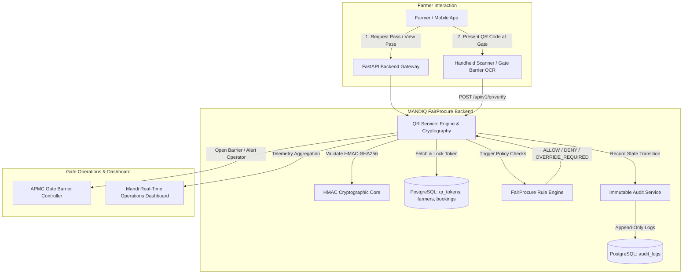
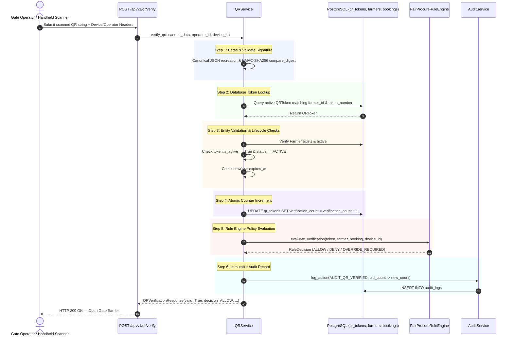

# MANDIQ FairProcure Layer — QR Identity & Verification Module (Sprint 2)

## 1. Executive Summary & Architecture Overview

The **QR Identity & Verification Module** is the foundational zero-trust identity layer of MANDIQ FairProcure. It converts APMC arrivals into cryptographically verifiable digital passes, eliminating gate fraud, impersonation, unscheduled arrivals, and weighbridge congestion.



### Key Architectural Pillars
1. **Cryptographic Zero-Trust**: QRs are signed dynamically with HMAC-SHA256 over a deterministic canonical JSON payload using the application's secure key (`SECRET_KEY`).
2. **Deterministic Payload Structure**: Internal secret database hashes are never exposed. The QR payload contains only verified public identity markers.
3. **Dynamic Vector & Raster Rendering**: Pass images are dynamically generated in PNG and SVG formats using in-memory streams (`io.BytesIO`), without relying on static file storage.
4. **Active Identity Guarantee**: Database partial unique index (`uq_active_farmer_qr`) guarantees that a farmer can possess at most one active QR code at any time, while full historical versions are retained (`version=1, 2, 3...`).
5. **Separation of Concerns**: Route handlers are strictly stateless presentation controllers. All business logic, cryptographic signing, policy evaluation, and audit logging reside in `QRService` and `FairProcureRuleEngine`.

---

## 2. Cryptographic Security Design

### 2.1 Payload Serialization & HMAC-SHA256 Canonical String
The QR payload embeds the following strictly ordered fields:
```json
{
  "farmer_id": "4b68ef5d-75fa-4c6e-8260-2646aa577f88",
  "booking_id": "673f8b0d-2e45-4209-a78d-eaec7f53eb90",
  "token_number": "MND-2026-FARM-0012",
  "slot_start": "2026-09-12T08:00:00",
  "slot_end": "2026-09-12T12:00:00",
  "issued_at": "2026-09-12T07:30:00",
  "version": 1,
  "signature": "a78ef409c91629837920abce620b721e06d9d1b643a53e4c4980bb29007f35ae"
}
```

#### Signature Generation Protocol:
1. The dictionary of core fields (`farmer_id`, `booking_id`, `token_number`, `slot_start`, `slot_end`, `issued_at`, `version`) is extracted.
2. The dictionary is canonically serialized into a byte sequence using `json.dumps(..., sort_keys=True, separators=(',', ':'))`.
3. An HMAC-SHA256 digest is generated against the canonical byte sequence using `app_settings.SECRET_KEY`:
   $$\text{signature} = \text{HMAC-SHA256}(\text{key} = \text{SECRET\_KEY}, \text{data} = \text{CanonicalBytes})$$
4. The hex-encoded signature is appended as `"signature"`.

### 2.2 Tamper Detection & Replay Defense
- **Zero-Knowledge Internal State**: No internal secret password hashes or operational database keys are stored in the QR payload.
- **Constant-Time Verification**: Verification uses `hmac.compare_digest(provided_sig, expected_sig)` to prevent timing attacks.
- **Payload Tampering Rejection**: Altering any character in the payload (e.g., modifying `token_number` or extending `slot_end`) immediately causes signature mismatch and logs `AUDIT_QR_FAILED` with `REASON=INVALID_SIGNATURE`.
- **Soft Revocation on Regeneration**: Generating a new QR token for a farmer deactivates earlier tokens (`is_active=False`, `status=REVOKED`), increments the `version` counter, and retains the prior record for audit trail preservation.

---

## 3. End-to-End Verification Pipeline

### 3.1 Verification Flowchart



---

## 4. API Endpoints Specification

### 4.1 Generate QR Token
- **Endpoint**: `POST /api/v1/qr/generate/{farmer_id}`
- **Description**: Generates an initial or refreshed signed QR identity token for the specified farmer.
- **Response**: `200 OK`
```json
{
  "token_id": "0df81e1e-2ce0-482a-9e79-5ee45f7823e2",
  "farmer_id": "4b68ef5d-75fa-4c6e-8260-2646aa577f88",
  "farmer_name": "Ramesh Patel",
  "booking_id": "673f8b0d-2e45-4209-a78d-eaec7f53eb90",
  "token_number": "MND-2026-FARM-0012",
  "status": "ACTIVE",
  "version": 1,
  "verification_count": 0,
  "qr_payload": "{\"booking_id\":\"...\",\"farmer_id\":\"...\",\"issued_at\":\"...\",\"signature\":\"...\"}",
  "qr_png_base64": "data:image/png;base64,iVBORw0KGgoAAAANSUhEUgAAA...",
  "slot_start": "2026-09-12T08:00:00",
  "slot_end": "2026-09-12T12:00:00",
  "expires_at": "2026-09-15T08:00:00"
}
```

---

### 4.2 Verify QR Identity & Evaluate Rules
- **Endpoint**: `POST /api/v1/qr/verify`
- **Headers**:
  - `X-Device-ID`: Optional handheld scanner / barrier terminal identifier (e.g. `GATE-NORTH-BARRIER-01`).
  - `X-Operator-ID`: Optional gatekeeper / security officer username.
- **Request Body**:
```json
{
  "qr_data": "{\"farmer_id\":\"4b68ef5d-75fa-4c6e-8260-2646aa577f88\",\"booking_id\":\"673f8b0d-2e45-4209-a78d-eaec7f53eb90\",\"token_number\":\"MND-2026-FARM-0012\",\"slot_start\":\"2026-09-12T08:00:00\",\"slot_end\":\"2026-09-12T12:00:00\",\"issued_at\":\"2026-09-12T07:30:00\",\"version\":1,\"signature\":\"a78ef409c9162...\"}",
  "device_id": "GATE-NORTH-BARRIER-01",
  "operator_id": "gatekeeper_rajesh"
}
```
- **Response**: `200 OK`
```json
{
  "valid": true,
  "status": "VALID",
  "message": "QR identity authenticity and slot verified successfully.",
  "rule_decision": "ALLOW",
  "rule_reason": "Active booking confirmed within valid gate admission window.",
  "farmer_id": "4b68ef5d-75fa-4c6e-8260-2646aa577f88",
  "farmer_name": "Ramesh Patel",
  "booking_id": "673f8b0d-2e45-4209-a78d-eaec7f53eb90",
  "token_number": "MND-2026-FARM-0012",
  "version": 1,
  "verification_count": 1,
  "last_scanned_at": "2026-09-12T08:15:30",
  "verified_at": "2026-09-12T08:15:30"
}
```
- **Failure Responses**: Returns `400 Bad Request` with structured `QRErrorResponse` if signature is forged, payload is tampered, token is expired, or identity is revoked.

---

### 4.3 Regenerate QR Token (Version Increment)
- **Endpoint**: `POST /api/v1/qr/regenerate/{farmer_id}`
- **Description**: Atomically revokes the existing active token, increments the version (`v1` $\to$ `v2`), re-signs a fresh cryptographic token, and records `AUDIT_QR_REGENERATED`.
- **Request Body**:
```json
{
  "reason": "Farmer lost printed physical pass",
  "operator_id": "gate_supervisor_amit"
}
```
- **Response**: `200 OK` with newly generated QR metadata and `version: 2`.

---

### 4.4 Dynamic QR Download (PNG, SVG, JSON)
- **Endpoint**: `GET /api/v1/qr/{farmer_id}?format={png|svg|json}`
- **Formats**:
  - `png`: Returns `StreamingResponse(content_type="image/png")` with `Content-Disposition: inline; filename="farmer_qr_{id}.png"`.
  - `svg`: Returns `Response(content_type="image/svg+xml")` containing vector XML.
  - `json`: Returns `QRMetadataResponse` JSON payload.

---

### 4.5 Mandi Dashboard Telemetry
- **Endpoint**: `GET /api/v1/qr/dashboard/metrics` (Also accessible via `/api/v1/dashboard/qr-metrics`)
- **Response**: `200 OK`
```json
{
  "today_qr_generated": 42,
  "today_qr_verified": 118,
  "verification_failures": 3,
  "expired_qr": 2,
  "active_qr": 156,
  "revoked_qr": 5,
  "verification_success_rate": 97.52,
  "total_qr_issued": 161,
  "timestamp": "2026-09-12T08:30:00"
}
```

---

## 5. Integration with Rule Engine

The `FairProcureRuleEngine.evaluate_verification()` handles gate clearance logic without polluting API controller routes:

| Condition | Decision | Action |
| :--- | :--- | :--- |
| Valid QR + Confirmed Booking + Within Slot Window | `ALLOW` | Gate barrier opens automatically. Weighbridge queue entry created. |
| Farmer has no confirmed booking in system | `OVERRIDE_REQUIRED` | Requires supervisor manual override (`POST /api/v1/fairprocure/overrides`). |
| Arrival outside slot window (> 60 mins early / late) | `OVERRIDE_REQUIRED` | Mandi queue slot buffer exceeded; flagged for floor supervisor. |
| Daily commodity delivery quota exceeded (> 50 MT) | `DENY` | Rejection logged; farmer redirected to APMC liaison. |

---

## 6. Integration with Audit Service

Every QR operation writes an immutable record to the `audit_logs` table:

```sql
INSERT INTO audit_logs (
    entity_type, entity_id, action, performed_by, device_id, 
    old_value, new_value, remarks, created_at
) VALUES (
    'QRToken', '0df81e1e-2ce0-482a-9e79-5ee45f7823e2', 'QR_VERIFIED',
    'gatekeeper_rajesh', 'GATE-NORTH-BARRIER-01',
    '{"verification_count": 0}',
    '{"verification_count": 1, "verified_at": "2026-09-12T08:15:30"}',
    'QR identity verified successfully for Ramesh Patel at gate barrier',
    '2026-09-12 08:15:30'
);
```

Actions audited:
- `QR_GENERATED`: Triggered on initial issuance.
- `QR_VERIFIED`: Triggered on successful gate scan; records scan counter delta.
- `QR_FAILED`: Triggered on signature mismatch, expired pass, or revoked token.
- `QR_REGENERATED`: Triggered on version bump; records previous and new token IDs.
- `QR_REVOKED`: Triggered on manual security lockout.

---

## 7. Real-World APMC Gate Hardware Integration

Handheld barcode scanners and barrier turnstiles can integrate directly with the endpoint:

```bash
curl -X POST "http://127.0.0.1:8000/api/v1/qr/verify" \
  -H "Content-Type: application/json" \
  -H "X-Device-ID: BARRIER-GATE-01" \
  -H "X-Operator-ID: officer_sharma" \
  -d '{
    "qr_data": "<RAW_SCANNED_STRING_FROM_SCANNER>",
    "device_id": "BARRIER-GATE-01",
    "operator_id": "officer_sharma"
  }'
```

---

## 8. Test Suite Summary

All test cases are implemented in [test_sprint2_qr_module.py](file:///d:/projects/mandiq%20dashboard/backend/tests/test_sprint2_qr_module.py):

| Test Case | Scenario | Expected Outcome |
| :--- | :--- | :--- |
| `test_qr_generation` | Initial issuance for farmer | Signed payload, PNG data URI, DB storage |
| `test_qr_download_formats` | `format=png`, `svg`, `json` | Correct MIME headers and binary/XML content |
| `test_qr_verification_valid` | Scanner reading valid pass | HMAC match, Rule `ALLOW`, audit log created |
| `test_tampered_qr_payload` | Attacker changes `token_number` | Signature mismatch, `INVALID_SIGNATURE`, HTTP 400 |
| `test_wrong_signature` | Spoofed digital signature | Rejected, `INVALID_SIGNATURE`, HTTP 400 |
| `test_expired_qr` | Scanned after `expires_at` | Rejected, `EXPIRED`, HTTP 400 |
| `test_inactive_revoked_qr` | Scanned after deactivation | Rejected, `REVOKED`, HTTP 400 |
| `test_qr_regeneration_versioning` | Re-issue lost pass | v1 marked inactive, v2 created, history preserved |
| `test_concurrent_verification` | 5 concurrent scanner hits | Atomic SQL update, exact counter tally, zero race |
| `test_dashboard_metrics` | Telemetry endpoint call | All metrics aggregated and returned with 200 OK |
