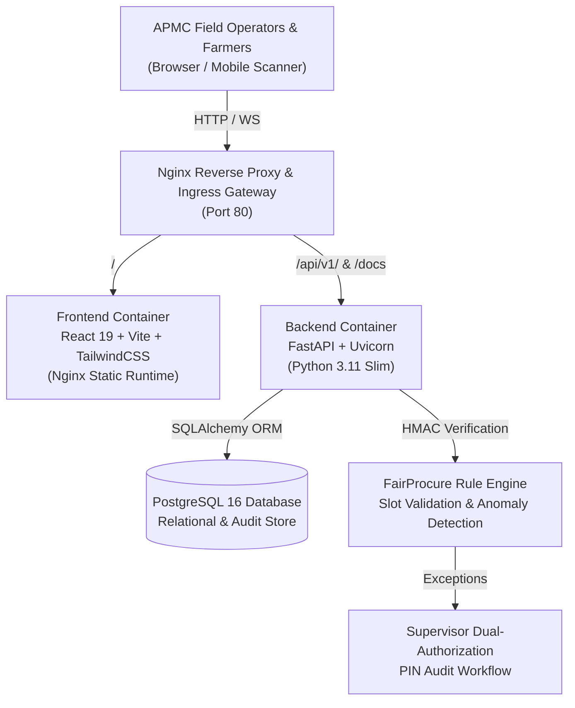

# MANDIQ — APMC FairProcure Platform
### Next-Generation Cryptographic Governance & Fair Agricultural Intake Engine

[](https://github.com/mandiq/mandiq-platform/actions)
[](https://www.python.org/)
[](https://fastapi.tiangolo.com)
[](https://react.dev/)
[](https://www.docker.com/)
[](https://opensource.org/licenses/MIT)

---

## 🌾 Executive Summary

**MANDIQ** is an enterprise-grade agricultural market operations platform designed to solve one of the greatest challenges in Indian APMC (*Agricultural Produce Market Committee*) mandis: **corruption, queue jumping, cartelization, and lack of transparency during crop procurement**.

By integrating **cryptographic HMAC-SHA256 QR tokens**, an automated **FIFO Rule Enforcement Engine**, a dual-authorized **Supervisor Exception Protocol**, and **real-time yard telemetry**, MANDIQ guarantees that every farmer—regardless of landholding size or political influence—is served strictly according to their scheduled slot.

---

## 🏛 Architecture Overview



### Core Technology Stack

| Layer | Technology | Purpose |
|---|---|---|
| **Gateway** | Nginx 1.27 Alpine | Ingress routing, SSL termination, security headers, reverse proxy |
| **Frontend** | React 19, TypeScript, Vite 8 | Live operations console, interactive telemetry, QR scanner |
| **Styling** | TailwindCSS, Framer Motion, Lucide | APMC government-grade aesthetic with day/night ambient modes |
| **Backend** | Python 3.11, FastAPI, Pydantic v2 | High-throughput asynchronous REST API, rate limiting, logging |
| **Database** | PostgreSQL 16 Alpine, Alembic | Relational data integrity, ACID transactional audits, pooling |
| **Security** | HMAC-SHA256, OWASP Headers | Cryptographic QR issuance, anti-tamper digital signatures |

---

## 🚀 Quickstart: Running with Docker Compose

The simplest way to spin up the complete MANDIQ production stack is via Docker Compose:

```bash
# 1. Clone the repository
git clone https://github.com/your-org/mandiq-dashboard.git
cd "mandiq dashboard"

# 2. Configure environment variables
cp .env.example .env

# 3. Start all services (PostgreSQL, Backend, Frontend, Gateway)
docker compose up --build
```

### 🌐 Access URLs Once Containers are Healthy:
- **Operations Console (UI)**: [http://localhost](http://localhost) (or port 80)
- **Interactive API Documentation (Swagger)**: [http://localhost/docs](http://localhost/docs)
- **Alternative Documentation (ReDoc)**: [http://localhost/redoc](http://localhost/redoc)
- **Health Check**: [http://localhost/health](http://localhost/health)

---

## 🛠 Local Development Setup (Bare Metal)

If you prefer running the backend and frontend directly on your local machine:

### Prerequisites
- **Python 3.11+**
- **Node.js 20+** and **npm**
- **PostgreSQL 16** running locally

### 1. Backend Setup
```bash
cd backend

# Create and activate virtual environment
python -m venv venv
# Windows:
.\venv\Scripts\activate
# Linux/macOS:
source venv/bin/activate

# Install dependencies
pip install -r requirements.txt

# Configure environment
cp .env.example .env
# Ensure DATABASE_URL points to your PostgreSQL instance

# Run Alembic migrations
alembic upgrade head

# Start development server
uvicorn app.main:app --reload --host 127.0.0.1 --port 8000
```

### 2. Frontend Setup
```bash
cd frontend

# Install packages
npm install

# Run frontend test suite
npm test

# Run linter
npm run lint

# Start Vite development server
npm run dev
```

The frontend will be live at `http://localhost:5173`, automatically proxying requests to the backend at `http://localhost:8000`.

---

## 🔐 Security & Governance Model

MANDIQ enforces multi-layered defense to safeguard APMC operations:
1. **Cryptographic Identity Tokens**: Farmer tokens are cryptographically signed using HMAC-SHA256 with the server's private secret. Even if a QR code is visually altered or forged, the digital signature check rejects it immediately.
2. **Anti-Queue-Jumping Rule Engine**: Verifies that no farmer enters ahead of earlier waiting tokens in the same commodity class unless explicit supervisor authorization is granted.
3. **Supervisor Dual-PIN Authorization**: Out-of-turn admissions (e.g., highly perishable tomatoes damaged by unseasonal rain) require the on-duty APMC Mandi Secretary to enter their supervisor PIN, creating an indelible tamper-proof record in the audit logs.
4. **OWASP Hardened Headers**: Includes `X-Frame-Options: DENY`, `X-Content-Type-Options: nosniff`, and restrictive `Content-Security-Policy`.
5. **Rate Limiting**: Defends sensitive endpoints (`/qr/verify`, `/override/approve`, `/procurement/start`) from brute-force scanning.

---

## 📡 API Overview

The platform exposes over 45 REST endpoints under `/api/v1`:

| Area | Method | Endpoint | Description |
|---|---|---|---|
| **System** | `GET` | `/health` | Live service health & PostgreSQL connectivity ping |
| **Dashboard** | `GET` | `/api/v1/dashboard/summary` | Real-time intake metrics, queue counts, and yard status |
| **Queue** | `GET` | `/api/v1/queue/live` | Ordered list of waiting and serving farmers |
| **Queue** | `POST` | `/api/v1/queue/call-next` | Advance next FIFO token to specified weighbridge bay |
| **FairProcure** | `POST` | `/api/v1/fairprocure/procurement/start` | Rule Engine validation gatekeeper check |
| **QR Identity** | `POST` | `/api/v1/qr/generate` | Issues signed HMAC-SHA256 QR token |
| **QR Identity** | `POST` | `/api/v1/qr/verify` | Validates QR signature, token status, and expiration |
| **Overrides** | `POST` | `/api/v1/fairprocure/override/approve` | Supervisor PIN approval for emergency exceptions |
| **Analytics** | `GET` | `/api/v1/fairprocure/analytics/fairness-score` | Live equity index (0-100) & queue latency stats |
| **Audit** | `GET` | `/api/v1/audit-events` | Immutable log of all yard interventions & approvals |

---

## 📂 Project Structure

```
mandiq-dashboard/
├── .github/
│   └── workflows/
│       └── ci.yml             # GitHub Actions CI pipeline
├── backend/
│   ├── alembic/               # Database migrations
│   ├── app/
│   │   ├── api/               # REST API endpoints & route aggregation
│   │   ├── core/              # Settings, constants, and enums
│   │   ├── database/          # SQLAlchemy engine & session setup
│   │   ├── middleware/        # Security headers, rate-limiting, request latency
│   │   ├── models/            # SQLAlchemy database models
│   │   ├── schemas/           # Pydantic request/response validation schemas
│   │   └── services/          # Business logic, Rule Engine & QR crypto
│   ├── tests/                 # Backend pytest test suite (38 automated tests)
│   ├── Dockerfile             # Multi-stage Python 3.11 container definition
│   ├── entrypoint.sh          # Auto-migration & uvicorn startup script
│   └── requirements.txt       # Production Python dependencies
├── frontend/
│   ├── src/
│   │   ├── __tests__/         # Vitest UI component & integration tests
│   │   ├── api/               # Typed Axios API clients
│   │   ├── components/        # Modals, drawers, tables, and Ashoka Chakra UI
│   │   ├── hooks/             # Custom React hooks (polling, audio)
│   │   ├── types/             # TypeScript domain definitions
│   │   └── App.tsx            # Main operations console
│   ├── Dockerfile             # Node builder + Nginx static server image
│   ├── nginx.conf             # Frontend container SPA routing & caching
│   └── vite.config.ts         # Vite configuration with chunk splitting
├── nginx/
│   └── nginx.conf             # Root ingress gateway reverse proxy
├── docker-compose.yml         # Multi-service production orchestration
├── .env.example               # Environment variables template
├── DEPLOYMENT.md              # Production deployment & operations runbook
├── DEMO_GUIDE.md              # 5-Minute Hackathon Judge Demo Script
└── README.md                  # Project documentation
```

---

## 📸 Screenshots & Visual Tour

*(Placeholders for presentation screenshots)*
- **[Screenshot 1: Live Yard Operations Console]**: Real-time queue, weighbridge status, and PA announcement broadcast.
- **[Screenshot 2: FairProcure Rule Engine Gatekeeper]**: Instant detection of out-of-turn attempts with visual fairness score.
- **[Screenshot 3: Supervisor Dual-Authorization Modal]**: High-security PIN approval screen with tamper-proof audit trail.
- **[Screenshot 4: Cryptographic QR Scanner]**: Live camera scanner verifying HMAC-SHA256 digital signature.

---

## 🔧 Troubleshooting

### 1. Database Connection Refused
- **Symptom**: `sqlalchemy.exc.OperationalError: could not connect to server: Connection refused`
- **Fix**: Ensure PostgreSQL is running on port 5432 and credentials match `.env`. In Docker Compose, the host is `postgres`, not `localhost`.

### 2. Migration Version Mismatch
- **Symptom**: `alembic.util.exc.CommandError: Can't locate revision identified by 'xxxx'`
- **Fix**: Run `alembic upgrade head` from inside the `backend` directory.

### 3. Port 80 Already in Use
- **Symptom**: `Bind for 0.0.0.0:80 failed: port is already allocated`
- **Fix**: Modify the gateway port binding in `docker-compose.yml` (e.g., `"8080:80"`).

---

## ⚖ License

This project is licensed under the MIT License - see the [LICENSE](LICENSE) file for details. Developed for Indian Agricultural Transparency & e-NAM Compliance.
