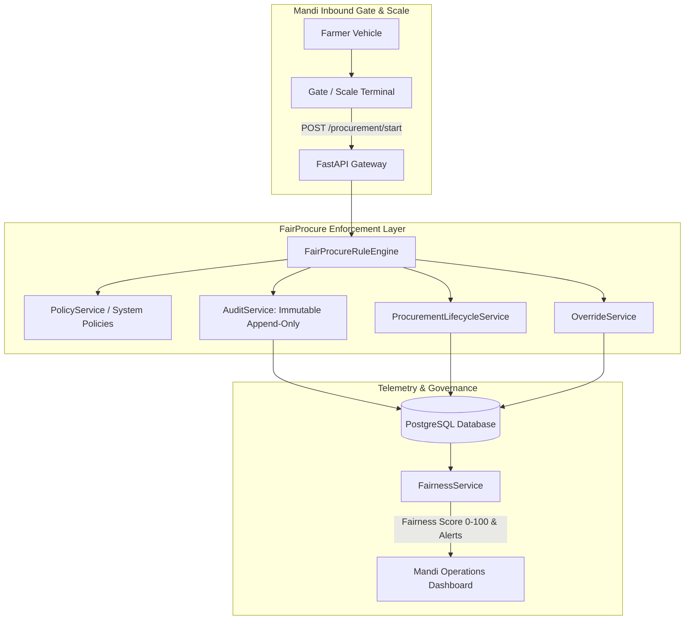
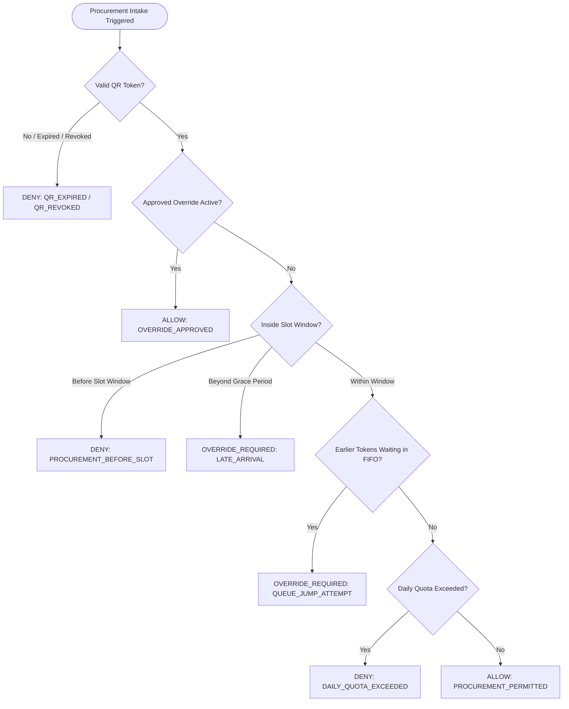
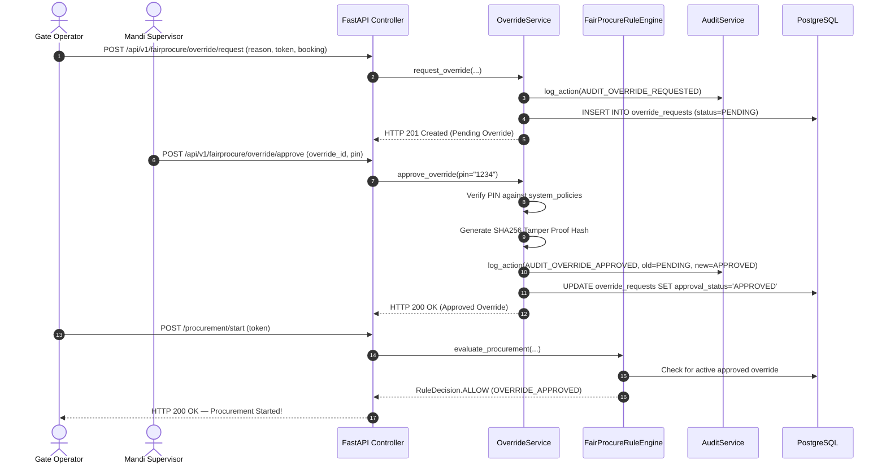

# MANDIQ FairProcure Enforcement Engine — Production Architecture (Sprint 4)

## 1. Executive Summary

The **FairProcure Enforcement Engine** is the core USP and fairness governance pillar of the MANDIQ platform. It upgrades FairProcure from passive logging into an **active, real-time procurement enforcement layer** designed to eliminate APMC mandi corrupt practices:

- **Queue Jumping Prevention**: Enforces strict FIFO queue sequences; blocks out-of-turn gate admission.
- **Punctuality & Slot Enforcement**: Dynamically checks arrival timestamps against booking slots and policy-driven buffers; rejects unauthorized early or expired arrivals.
- **Dual-Authorization Supervisor Overrides**: Mandates structured emergency justifications and supervisor PIN cryptographic validation for out-of-turn procurement.
- **Full Procurement Lifecycle Governance**: Manages a 13-milestone directed state machine graph, preventing illegal state jumps.
- **Append-Only Immutable Auditing**: Records all sensitive actions with operator, device, client IP, timestamp, and state diffs.
- **Live Fairness Telemetry**: Dynamically calculates a $0-100$ Fairness Score and broadcasts real-time operational alerts.

---

## 2. Rule Engine Architecture & Decision Enums

All rule evaluation methods return strictly typed `RuleDecision` enums (`ALLOW`, `DENY`, `OVERRIDE_REQUIRED`), never ambiguous booleans:

### Centralized Evaluation Methods:
1. `evaluate_arrival(farmer_id, booking_id, arrival_time)`: Validates registration, booking existence, and slot timing.
2. `evaluate_qr(farmer_id, qr_token_record)`: Validates active status, cryptographic integrity, revocation, and expiration.
3. `evaluate_slot(booking_id, current_time)`: Enforces `arrival_buffer_minutes`, `slot_grace_period`, and `late_arrival_limit`.
4. `evaluate_procurement(booking_id, token_number, farmer_id)`: Server-side master gatekeeper invoked whenever `POST /procurement/start` is triggered.
5. `evaluate_override(override_request_id, supervisor_pin)`: Validates dual-authorization PIN and status.
6. `evaluate_transition(current_status, target_status)`: Enforces legal progression through the 13 procurement milestones.

---

## 3. Override Dual-Authorization Workflow

When an out-of-turn or early arrival occurs (e.g. perishable crop risk during rain), the gate staff cannot bypass the system unilaterally. Dual authorization is required:

---

## 4. Procurement Lifecycle State Machine

The procurement process advances through 13 discrete milestones governed by a strict directed graph:

$$\text{ARRIVED} \to \text{QR\_VERIFIED} \to \text{QUEUE\_ENTERED} \to \text{WAITING} \to \text{WEIGHMENT\_STARTED} \to \text{WEIGHMENT\_COMPLETED} \to \text{PROCUREMENT\_STARTED} \to \text{PROCUREMENT\_COMPLETED} \to \text{PAYMENT\_INITIATED} \to \text{PAYMENT\_COMPLETED} \to \text{EXITED}$$

- **Terminal States**: `EXITED`, `CANCELLED`, `FAILED`.
- **Illegal Transitions**: Jumping out of order (e.g. `PAYMENT_COMPLETED` $\to$ `ARRIVED` or `FAILED` $\to$ `WAITING`) raises HTTP 400 Bad Request.

---

## 5. Fairness Telemetry & Scoring Algorithm

The `FairnessService` calculates a real-time **Fairness Score ($0-100$)** for APMC operations:

$$\text{FairnessScore} = \max\Big(0.0,\, \min\Big(100.0,\, 100.0 - \sum \text{Penalties}\Big)\Big)$$

### Mathematical Penalty Distribution:
- **Queue Jump Attempts**: $-6.0$ points per blocked attempt (maximum penalty: $30$ points).
- **Duplicate Procurement Attempts**: $-10.0$ points per attempt (maximum penalty: $30$ points).
- **Hard Policy Violations & Denials**: $-3.0$ points each (maximum penalty: $20$ points).
- **Unapproved / Stale Overrides**: $-2.0$ points each (maximum penalty: $15$ points).
- **QR Identity Failure Rate**: $-0.5$ points for every $1\%$ failure rate above $5\%$ (maximum penalty: $10$ points).

### Live Fairness Telemetry Metrics (`GET /api/v1/dashboard/fairness`):
- `today_procurements`: Total successful intake milestones today.
- `today_overrides`: Total overrides filed today.
- `pending_overrides`: Pending requests awaiting supervisor review.
- `denied_attempts`: Total rule engine policy rejections today.
- `queue_jump_attempts`: Total attempts to serve out-of-turn tokens today.
- `early_arrival_attempts`: Total arrivals before scheduled slot buffers today.
- `average_waiting_time_minutes`: Average duration from arrival to weighbridge admission.
- `qr_success_rate`: Percentage of authentic QR passes verified.
- `qr_failure_rate`: Percentage of expired, revoked, or tampered QR attempts.
- `queue_compliance`: Strict FIFO adherence percentage.
- `fairness_score`: Live composite governance index ($0-100$).
- `audit_events_today`: Total immutable audit records logged today.

---

## 6. Real-Time Alert Stream (`GET /api/v1/dashboard/alerts`)

Categorized by severity and ordered newest first:

| Alert Type | Severity | Description |
| :--- | :--- | :--- |
| `QUEUE_JUMP_ATTEMPT` | `CRITICAL` | Out-of-turn token attempted admission ahead of waiting farmers. |
| `DUPLICATE_PROCUREMENT` | `CRITICAL` | Re-procurement attempt on an already completed booking. |
| `POLICY_VIOLATION` | `HIGH` | Incorrect supervisor PIN or security constraint breach. |
| `PENDING_OVERRIDE` | `HIGH` | Farmer override request awaiting supervisor review. |
| `REPEATED_QR_FAILURE` | `HIGH` | Tampered or invalid digital pass scanned at gate kiosk. |
| `REVOKED_QR` | `HIGH` | Farmer with deactivated credentials attempted gate access. |
| `EARLY_PROCUREMENT_ATTEMPT` | `MEDIUM` | Farmer arrived before permissible arrival buffer window. |

---

## 7. API Endpoints Reference

### 7.1 Procurement Governance
- `POST /api/v1/procurement/start` (Direct root alias: `/procurement/start`):
  - Request: `{"booking_id": "...", "token_number": 12, "bay_number": 1, "operator_id": "Gate 01"}`
  - Response (Success): `HTTP 200 OK` with `ProcurementStartResponse`.
  - Response (Violation): `HTTP 400 Bad Request` with `{"decision": "DENY", "reason": "PROCUREMENT_BEFORE_SLOT", "slot": "13:00", "current_time": "10:05"}`.
- `POST /api/v1/procurement/transition`:
  - Advances milestone across 13 states with transition graph validation.
- `GET /api/v1/procurement/timeline/{booking_id}`:
  - Retrieves chronological milestone audit events for a booking.

### 7.2 Supervisor Overrides
- `POST /api/v1/fairprocure/override/request`: Submit override with mandatory reason.
- `POST /api/v1/fairprocure/override/approve`: Authorize override using supervisor PIN.
- `POST /api/v1/fairprocure/override/reject`: Deny override with rejection reason.
- `GET /api/v1/fairprocure/override/pending`: List pending requests awaiting supervisor action.
- `GET /api/v1/fairprocure/override/history`: Full chronological audit log of all overrides.

### 7.3 Dashboard Analytics
- `GET /api/v1/dashboard/fairness`: Comprehensive real-time governance metrics and Fairness Score.
- `GET /api/v1/dashboard/alerts`: Live operational alert feed for the dashboard alert drawer.

---

## 8. Database Changes & Migrations

Alembic migration `4c2a93e1b789_sprint4_enforcement_policies.py` applied:
1. Added `ip_address` (`String(45)`, nullable) to `audit_logs` table.
2. Seeded dynamic system policies in `system_policies`:
   - `arrival_buffer_minutes`: 30 minutes.
   - `qr_required`: true.
   - `override_requires_supervisor`: true.
   - `max_daily_procurement`: 500 quintals.
   - `slot_grace_period`: 15 minutes.
   - `late_arrival_limit`: 60 minutes.
   - `queue_reorder_allowed`: false.
   - `supervisor_pin`: "1234".

---

## 9. Judge Demonstration Script (SIH 2026 Presentation)

1. **Demonstrate Queue Jump Prevention**:
   - Show two farmers in queue: Token 10 (FIFO first) and Token 11 (second).
   - Attempt to serve Token 11 out of turn via `POST /procurement/start`.
   - Show immediate rejection: `{"decision": "OVERRIDE_REQUIRED", "reason": "QUEUE_JUMP_ATTEMPT"}`.
   - Point out live alert appearing in `GET /api/v1/dashboard/alerts` and deduction in Fairness Score.
2. **Demonstrate Early Arrival Rejection**:
   - Attempt to start procurement for a farmer scheduled for 11:00 PM.
   - Show immediate rejection: `{"decision": "DENY", "reason": "PROCUREMENT_BEFORE_SLOT", "slot": "11:00 PM", "current_time": "10:15 AM"}`.
3. **Demonstrate Dual-Authorization Supervisor Override**:
   - Gatekeeper submits override request: "Heavy rain risk; perishables must be unloaded immediately".
   - Supervisor enters PIN `1234` to approve.
   - Re-attempt procurement: Rule Engine clears with `ALLOW: OVERRIDE_APPROVED` and gate barrier opens.
4. **Demonstrate Immutable Audit Log**:
   - Query `/api/v1/audit-events`: Show append-only log with SHA-256 proof hash, client IP, device ID, and state transition diffs.
5. **Demonstrate Real-Time Dashboard Fairness Score**:
   - Show `GET /api/v1/dashboard/fairness` displaying the live calculated score ($0-100$) and queue compliance telemetry.
